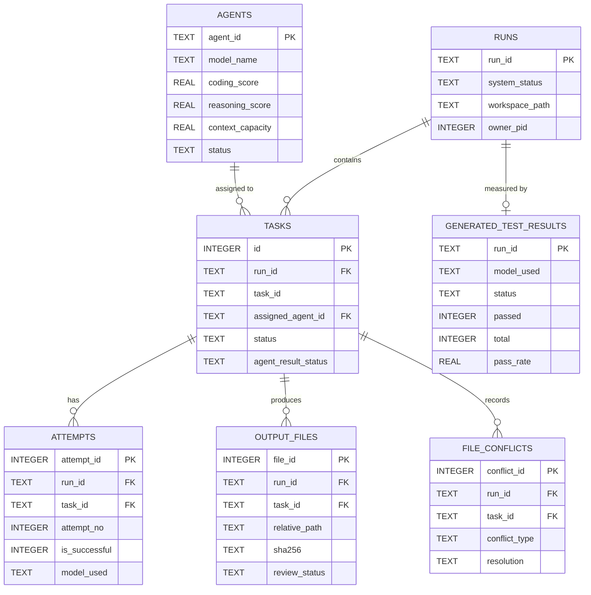

# Data Model and Persistence Design

**Iteration:** Iteration 1 (S1-04) → updated in Iteration 2 (S2-07) → updated in Iteration 3 (S3-04) → updated in Iteration 4 (S4-04) → harmonized in Iteration 5 (S5-02, S5-04)  
**Task ID:** S1-04, S2-07, S3-04, S4-04, S5-02, S5-04  
**Assignee:** Mahmut Karaalioğlu (Database Agent)  
**Reviewer:** İrem Yılmaz (Scrum Master)  
**Source of truth:** [`src/master/db_manager.py`](../src/master/db_manager.py) — schema version `5` (`PRAGMA user_version`)  
**Workspace & conflict modules:** [`src/master/workspace.py`](../src/master/workspace.py) (`workspaces/{run_id}/`) and [`src/master/conflicts.py`](../src/master/conflicts.py)  

## 1. Persistent Storage vs. In-Memory State (State Allocation)
In our distributed AI agent platform, data is categorized into two main storage types:

**Information Requiring Persistent Storage (Persistent Data):**
* Parsed sub-tasks (Task details, requirements, dependencies)
* Task assignments and execution statuses (`PENDING`, `IN_PROGRESS`, `COMPLETED`, `FAILED`, `UNASSIGNED`, `BLOCKED`)
* Persistent agent profiles and their capability scores (`coding`, `reasoning`, `context_capacity`)
* Error logs and execution attempt history (crucial for bounded retry and failover self-correction)
* Output file metadata, SHA-256 hashes, AST review verdicts, and file/schema conflict resolutions

**State Required Only During Runtime (In-Memory State):**
* Real-time HTTP `/health` ping responses of distributed worker nodes
* UI (Streamlit) session state, progress bars, and temporary render data
* Raw prompts generated and sent to the LLM during active execution

## 2. SQLite Tables (Data Dictionary — Implemented)

All tables are created with `CREATE TABLE IF NOT EXISTS` by `init_db()`, which is called automatically when `MasterOrchestrator` is constructed. The database file is `state.db` in the project root (override with the `STATE_DB_PATH` environment variable) and is excluded via `.gitignore`. Connections use `PRAGMA journal_mode=WAL` and `PRAGMA foreign_keys=ON`.

### `runs` — one row per orchestrator execution
| Column | Type | Notes |
| :--- | :--- | :--- |
| `run_id` | TEXT **PK** | Generated by `TaskScheduler.reset()` (e.g. `run-1a2b3c4d`) |
| `project_title` | TEXT | |
| `requirement_id` | TEXT | From `RequirementsAnalyzer.decompose()` |
| `system_status` | TEXT | `RUNNING`, `COMPLETED`, `PARTIALLY_COMPLETED`, `FAILED`, `ABORTED` (CHECK) |
| `total_tasks` | INTEGER | |
| `completed_count`, `failed_count`, `unassigned_count`, `blocked_count` | INTEGER | Final status counters |
| `workspace_path` | TEXT | S3-04: absolute root directory for this run's artifacts (`workspaces/{run_id}`) |
| `owner_pid` | INTEGER | OS process ID that created the run (used for automatic stale `RUNNING` recovery) |
| `started_at`, `finished_at` | TIMESTAMP | Used for end-to-end latency & Sprint 5 telemetry calculations |

### `agents` — persistent agent capability profiles
| Column | Type | Notes |
| :--- | :--- | :--- |
| `agent_id` | TEXT **PK** | `BaseAgent.agent_id` |
| `name` | TEXT NOT NULL | e.g. Backend Agent |
| `model_name` | TEXT | Underlying Ollama LLM (e.g. `qwen2.5-coder:7b`) |
| `coding_score`, `reasoning_score`, `context_capacity` | REAL | 0–100 (CHECK) |
| `specialties` | TEXT (JSON array) | |
| `provenance` | TEXT (JSON object) | Per-metric `estimated` / `measured` |
| `status` | TEXT | `IDLE`, `BUSY`, `OFFLINE`, `ERROR` (CHECK) |
| `current_task_id` | TEXT | |
| `updated_at` | TIMESTAMP | Upserted at run start and run end |

### `tasks` — per-run task results
| Column | Type | Notes |
| :--- | :--- | :--- |
| `id` | INTEGER **PK** AUTOINCREMENT | Surrogate key |
| `run_id` | TEXT NOT NULL **FK** → `runs.run_id` | `ON DELETE CASCADE` |
| `task_id` | TEXT NOT NULL | Unique per run: `UNIQUE(run_id, task_id)` |
| `title`, `description`, `category` | TEXT | |
| `required_capability` | TEXT | Task `required_specialty` |
| `dependencies` | TEXT (JSON array) | |
| `assigned_agent_id` | TEXT **FK** → `agents.agent_id` | |
| `assigned_agent_name`, `model_used` | TEXT | |
| `fit_score` | REAL | |
| `status` | TEXT | `PENDING`, `IN_PROGRESS`, `COMPLETED`, `FAILED`, `UNASSIGNED`, `BLOCKED` (CHECK) |
| `agent_result_status` | TEXT | `SUCCESS`, `FAILED` or NULL |
| `reason` | TEXT | Failure / block explanation |
| `attempted_agents` | TEXT (JSON array) | Failover order |
| `output_files` | TEXT (JSON array) | S3-04: relative paths within `workspaces/{run_id}/` written by this task |
| `execution_time_seconds` | REAL | |
| `created_at`, `updated_at` | TIMESTAMP | |

### `attempts` — failover attempt history (error detection & recovery)
| Column | Type | Notes |
| :--- | :--- | :--- |
| `attempt_id` | INTEGER **PK** AUTOINCREMENT | |
| `run_id`, `task_id` | TEXT **FK** → `tasks(run_id, task_id)` | `ON DELETE CASCADE` |
| `agent_id`, `agent_name` | TEXT | |
| `attempt_no` | INTEGER | 1-based order within the task |
| `is_successful` | INTEGER | `0` / `1` (CHECK) |
| `error_message` | TEXT | Sanitized exception message on failure |
| `execution_time_seconds` | REAL | |
| `model_used` | TEXT | S4-04: model tag used in this attempt |
| `created_at` | TIMESTAMP | |

### `output_files` — generated file metadata (S4-04)
Actual file contents live on disk under `workspaces/{run_id}/`; SQLite stores only metadata and review verdicts (`UNIQUE(run_id, task_id, relative_path)`):
| Column | Type | Notes |
| :--- | :--- | :--- |
| `file_id` | INTEGER **PK** AUTOINCREMENT | |
| `run_id`, `task_id` | TEXT **FK** → `tasks(run_id, task_id)` | `ON DELETE CASCADE` |
| `agent_name` | TEXT | Producing agent |
| `relative_path`, `requested_path` | TEXT | Actual path in workspace vs. originally requested path |
| `size_bytes` | INTEGER | `>= 0` (CHECK) |
| `sha256` | TEXT | 64-char hex digest (or NULL) |
| `review_status` | TEXT | `PENDING`, `APPROVED`, `REVIEW_REQUIRED`, `REJECTED` (CHECK) |
| `conflict_resolution` | TEXT | `RENAMED`, `DEDUPLICATED`, `REPORTED`, or NULL (CHECK) |
| `created_at`, `updated_at` | TIMESTAMP | |

### `file_conflicts` — path and schema conflicts (S4-04)
| Column | Type | Notes |
| :--- | :--- | :--- |
| `conflict_id` | INTEGER **PK** AUTOINCREMENT | |
| `run_id`, `task_id` | TEXT **FK** → `tasks(run_id, task_id)` | `ON DELETE CASCADE` |
| `conflict_type` | TEXT | `PATH` (same target path) or `SCHEMA` (different `CREATE TABLE` columns) |
| `file_path`, `resolved_path` | TEXT | Conflicting path and where the file was written |
| `other_task_id` | TEXT | Earlier task holding the path or canonical table |
| `resolution` | TEXT | `DEDUPLICATED` (same SHA-256), `RENAMED` (`<stem>.<task_id><ext>`), `REPORTED` (schema mismatch) |
| `detail` | TEXT | Human-readable explanation |
| `created_at` | TIMESTAMP | |

### `generated_test_results` — generated code test pass rates (S5-06)
| Column | Type | Notes |
| :--- | :--- | :--- |
| `run_id` | TEXT **PK, FK** → `runs.run_id` | `ON DELETE CASCADE`; one summary row per run |
| `model_used` | TEXT | Testing Agent Ollama model tag |
| `status` | TEXT NOT NULL | `PASSED`, `FAILED`, `SKIPPED` (CHECK) |
| `passed`, `failed`, `errors`, `skipped`, `total` | INTEGER | Execution counters (default `0`) |
| `pass_rate` | REAL | `passed / total` (NULL when `total = 0`) |
| `reason` | TEXT | Optional summary or skip reason |
| `created_at` | TIMESTAMP | |

### Telemetry Queries & Repeatable CSV/JSON Export (S5-04)
`src/master/db_manager.py` and `master_agent_projesi/run_export.py` expose deterministic read and export helpers for both the Streamlit Dashboard and the Model Comparison Report:
* **Queries (`src/master/db_manager.py`):** `get_run_history()`, `get_agent_telemetry()` (per-agent average duration, attempt/task success rates, attempt counts, and output file counts), `get_conflict_summary()`, `get_generated_test_pass_rates()`, and `get_telemetry_snapshot()`.
* **Repeatable Exports (`src/master/db_manager.py` & `master_agent_projesi/run_export.py`):** `export_telemetry_json()`, `export_agent_telemetry_csv()`, `export_run_history_csv()`, plus Streamlit download wrappers `build_telemetry_json_export()`, `build_agent_telemetry_csv_export()`, and `build_run_history_csv_export()`. Output ordering and rounding are deterministic so repeated exports on the same database state are byte-for-byte identical.

### Integrity rules — "never silently COMPLETED"
Failed, blocked or unassigned tasks are prevented from being stored as `COMPLETED` by three layers:
1. **Python guard:** `validate_task_record()` raises `ValueError` unless `agent_result_status = 'SUCCESS'` and an agent is assigned.
2. **Table CHECK:** `status != 'COMPLETED' OR (agent_result_status = 'SUCCESS' AND assigned_agent_name IS NOT NULL)`.
3. **Trigger `trg_tasks_no_failed_to_completed`:** aborts any `UPDATE` from `FAILED` / `UNASSIGNED` / `BLOCKED` to `COMPLETED`.

### Stale `RUNNING` run recovery
Runs interrupted mid-execution (exception, `KeyboardInterrupt`, Streamlit stop, or process crash) are prevented from remaining stuck in `RUNNING` by two layers:
1. **Runtime guard (`MasterOrchestrator.process_requirement`):** a `finally` block calls `db_manager.mark_run_aborted()` whenever a run exits before `finish_run()`.
2. **Startup recovery (`db_manager.recover_stale_runs()`, called by `init_db()`):** detects orphaned `RUNNING` rows whose `owner_pid` process is no longer alive or whose `started_at` exceeds `STALE_RUN_TIMEOUT_SECONDS` (default `1800` s), marks any `PENDING`/`IN_PROGRESS` tasks of that run as `FAILED`, updates task counters, sets `finished_at`, and closes the run as `ABORTED` (never left `RUNNING` and never silently `COMPLETED`). Existing v2–v4 `runs` tables are migrated in-place so their `CHECK` constraint accepts `ABORTED`.

### Legacy migration
If `init_db()` finds the Sprint 1 schema (`tasks` without `run_id`, `agents` without `agent_id`), those tables are renamed to `tasks_legacy_v1` / `agents_legacy_v1` and the new schema is created. Existing v2/v3/v4 databases are upgraded in-place via `_add_missing_columns()` and `CREATE TABLE IF NOT EXISTS`. No data is deleted.

## 3. Storage Options Comparison

| Method | Advantages | Disadvantages | Decision |
| :--- | :--- | :--- | :--- |
| **JSON / In-Memory** | Fast execution, zero setup required. | Total data loss on system crash. Prone to data corruption during concurrent writes by multiple agents. | **Rejected.** Unsafe for asynchronous distributed architecture. |
| **SQLite (WAL Mode)** | File-based, zero configuration required. ACID compliant. Prevents locks with WAL (Write-Ahead Logging) mode across parallel worker threads. | Single-host file lock limits multi-region horizontal scaling. | **Accepted.** Implemented across Sprints 1–5 (`schema v5`) for run persistence, conflict logs, and Sprint 5 telemetry export. |
| **PostgreSQL** | Most robust solution for multi-datacenter production systems. | Requires Docker or local server installation for every developer. | **Postponed.** (Can be migrated from `db_manager.py` later if needed). |

## 4. Entity-Relationship Diagram (ERD)

## 5. Verification & Architectural Decisions Resolved
- **Verification:** `python -m src.master.db_manager` initializes `state.db` and prints the status of each table. `tests/test_db_manager.py` and `tests/test_s4_failover_and_conflicts.py` verify fresh table creation, idempotent `init_db()`, legacy migration, `COMPLETED` integrity triggers, stale-run `ABORTED` recovery, and conflict persistence.
- **Resolved Design Decisions (carried over from S1-04):**
  - *Artifact Storage:* Generated code files are written physically to disk inside `workspaces/{run_id}/` via `src/master/workspace.py`, while SQLite (`output_files`) stores file paths, byte sizes, SHA-256 digests, and review verdicts.
  - *Attempt History Bounds:* Bounded retry policies (`src/master/retry_policy.py`) cap per-task retry loops (`max_retries`) and prevent unbounded database growth while preserving full auditability for Sprint 5 telemetry exports.