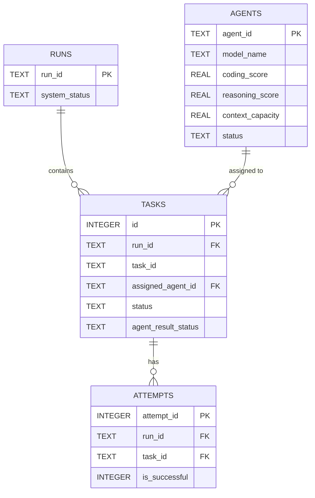

# Data Model and Persistence Design

**Iteration:** Iteration 1 (S1-04) → updated in Iteration 2 (S2-07)  
**Task ID:** S1-04, S2-07  
**Assignee:** İrem Yılmaz (Scrum Master)  
**Reviewer:** Mahmut Karaalioğlu  
**Source of truth:** [`src/master/db_manager.py`](../src/master/db_manager.py) — schema version `2` (`PRAGMA user_version`)  

## 1. Persistent Storage vs. In-Memory State (State Allocation)
In our distributed AI agent platform, data is categorized into two main storage types:

**Information Requiring Persistent Storage (Persistent Data):**
* Parsed sub-tasks (Task details, requirements)
* Task assignments and execution statuses (Pending, In Progress, Failed, Completed)
* Persistent agent profiles and their capability scores
* Error logs and execution attempt history (crucial for self-correction)
* Output file metadata and physical repository paths

**State Required Only During Runtime (In-Memory State):**
* Real-time WebSocket/API connection statuses of the agents (Ping/Pong)
* UI (Dashboard) progress bars and temporary render data
* Raw prompts generated and sent to the LLM during active execution

## 2. SQLite Tables (Data Dictionary — Implemented)

All tables are created with `CREATE TABLE IF NOT EXISTS` by `init_db()`, which is called automatically when `MasterOrchestrator` is constructed. The database file is `state.db` in the project root (override with the `STATE_DB_PATH` environment variable) and is excluded via `.gitignore`. Connections use `PRAGMA journal_mode=WAL` and `PRAGMA foreign_keys=ON`.

### `runs` — one row per orchestrator execution
| Column | Type | Notes |
| :--- | :--- | :--- |
| `run_id` | TEXT **PK** | Generated by `TaskScheduler.reset()` (e.g. `run-1a2b3c4d`) |
| `project_title` | TEXT | |
| `requirement_id` | TEXT | From `RequirementsAnalyzer.decompose()` |
| `system_status` | TEXT | `RUNNING`, `COMPLETED`, `PARTIALLY_COMPLETED`, `FAILED` (CHECK) |
| `total_tasks` | INTEGER | |
| `completed_count`, `failed_count`, `unassigned_count`, `blocked_count` | INTEGER | Final status counters |
| `started_at`, `finished_at` | TIMESTAMP | |

### `agents` — persistent agent capability profiles
| Column | Type | Notes |
| :--- | :--- | :--- |
| `agent_id` | TEXT **PK** | `BaseAgent.agent_id` |
| `name` | TEXT NOT NULL | e.g. Frontend Agent |
| `model_name` | TEXT | Underlying LLM (e.g. `qwen2.5-coder:7b`) |
| `coding_score`, `reasoning_score`, `context_capacity` | REAL | 0–100 (CHECK) |
| `specialties` | TEXT (JSON array) | |
| `provenance` | TEXT (JSON object) | Per-metric `estimated` / `measured` |
| `status` | TEXT | `IDLE`, `BUSY`, `OFFLINE`, `ERROR` (CHECK) |
| `current_task_id` | TEXT | |
| `updated_at` | TIMESTAMP | Upserted at run start and run end |

### `tasks` — per-run task results
| Column | Type | Notes |
| :--- | :--- | :--- |
| `id` | INTEGER **PK** AUTOINCREMENT | Surrogate key |
| `run_id` | TEXT NOT NULL **FK** → `runs.run_id` | `ON DELETE CASCADE` |
| `task_id` | TEXT NOT NULL | Unique per run: `UNIQUE(run_id, task_id)` |
| `title`, `description`, `category` | TEXT | |
| `required_capability` | TEXT | Task `required_specialty` |
| `dependencies` | TEXT (JSON array) | |
| `assigned_agent_id` | TEXT **FK** → `agents.agent_id` | |
| `assigned_agent_name`, `model_used` | TEXT | |
| `fit_score` | REAL | |
| `status` | TEXT | `PENDING`, `IN_PROGRESS`, `COMPLETED`, `FAILED`, `UNASSIGNED`, `BLOCKED` (CHECK) |
| `agent_result_status` | TEXT | `SUCCESS`, `FAILED` or NULL |
| `reason` | TEXT | Failure / block explanation |
| `attempted_agents` | TEXT (JSON array) | Failover order |
| `execution_time_seconds` | REAL | |
| `created_at`, `updated_at` | TIMESTAMP | |

### `attempts` — failover attempt history (error detection & recovery)
| Column | Type | Notes |
| :--- | :--- | :--- |
| `attempt_id` | INTEGER **PK** AUTOINCREMENT | |
| `run_id`, `task_id` | TEXT **FK** → `tasks(run_id, task_id)` | `ON DELETE CASCADE` |
| `agent_id`, `agent_name` | TEXT | |
| `attempt_no` | INTEGER | 1-based order within the task |
| `is_successful` | INTEGER | `0` / `1` (CHECK) |
| `error_message` | TEXT | Exception message on failure |
| `execution_time_seconds` | REAL | |
| `created_at` | TIMESTAMP | |

### Integrity rules — "never silently COMPLETED"
Failed, blocked or unassigned tasks are prevented from being stored as `COMPLETED` by three layers:
1. **Python guard:** `validate_task_record()` raises `ValueError` unless `agent_result_status = 'SUCCESS'` and an agent is assigned.
2. **Table CHECK:** `status != 'COMPLETED' OR (agent_result_status = 'SUCCESS' AND assigned_agent_name IS NOT NULL)`.
3. **Trigger `trg_tasks_no_failed_to_completed`:** aborts any `UPDATE` from `FAILED` / `UNASSIGNED` / `BLOCKED` to `COMPLETED`.

### Legacy migration
If `init_db()` finds the Sprint 1 schema (`tasks` without `run_id`, `agents` without `agent_id`), those tables are renamed to `tasks_legacy_v1` / `agents_legacy_v1` and the new schema is created. No data is deleted.

### Output File (planned — not yet implemented)
* `file_id` (PK): Unique file identifier
* `task_id` (FK): The task that generated this file
* `file_name`: Name of the generated file (e.g., `login.py`)
* `file_path`: Physical relative path within the shared repository
* `content_hash`: File hash to detect unauthorized or conflicting modifications

## 3. Storage Options Comparison
Currently, agent capabilities are stored statically in `config/agents_config.json`. However, this is insufficient for asynchronous task management.

| Method | Advantages | Disadvantages | Decision |
| :--- | :--- | :--- | :--- |
| **JSON / In-Memory** | Fast execution, zero setup required. | Total data loss on system crash. Prone to data corruption during concurrent writes by multiple agents. | **Rejected.** Unsafe for asynchronous distributed architecture. |
| **SQLite** | File-based, zero configuration required (Ideal for MVP). ACID compliant. Prevents locks with WAL (Write-Ahead Logging) mode. | May face performance bottlenecks in highly concurrent, multi-server production environments. | **Accepted.** Ideal solution for Sprints 1 and 2. |
| **PostgreSQL** | Most robust solution for distributed and production systems. | Requires Docker or local server installation for every developer. Over-engineering for Iteration 1. | **Postponed.** (Can be migrated from SQLite later if needed). |

## 4. Entity-Relationship Diagram (ERD)

## 5. Verification
`python -m src.master.db_manager` initializes `state.db` and prints the status of each table. `tests/test_db_manager.py` covers creating the tables on a fresh database, running init twice, legacy migration, the COMPLETED guards, and orchestrator persistence.

## 6. Open Questions and Decision Inputs (carried over from S1-04)
Output Files: Should we store the actual code strings returned by the LLM in the database (as BLOB/TEXT), or write them directly to the disk (.py, .js) and only store the file_path in the database? (Recommendation: Writing to disk and storing the path is safer for Git integration).

Attempt History: Should we implement a periodic pruning mechanism for the Attempt table to prevent database bloat from tasks that fail repeatedly?